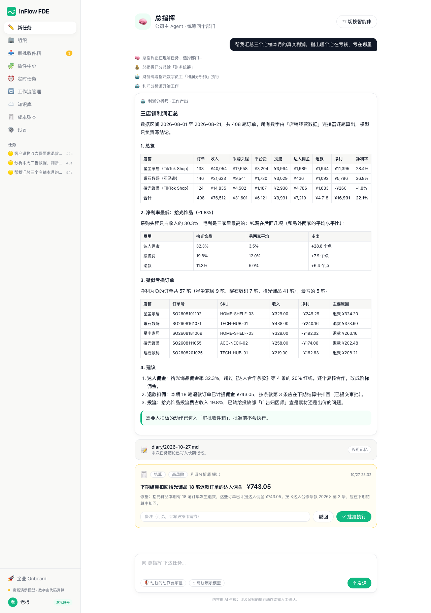
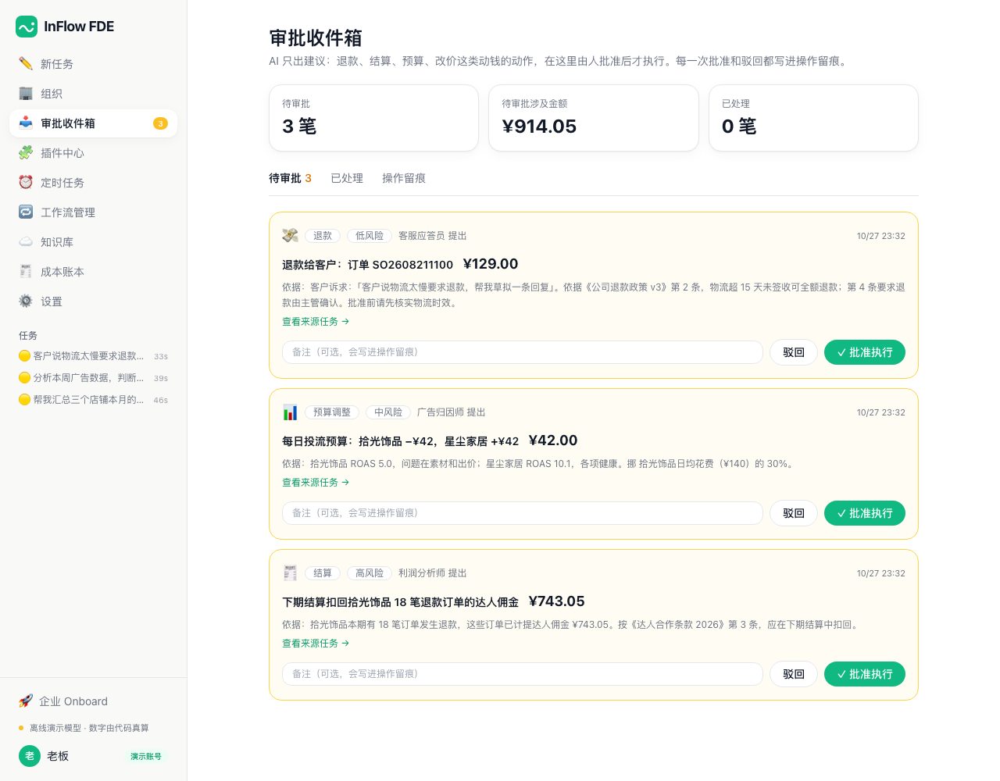
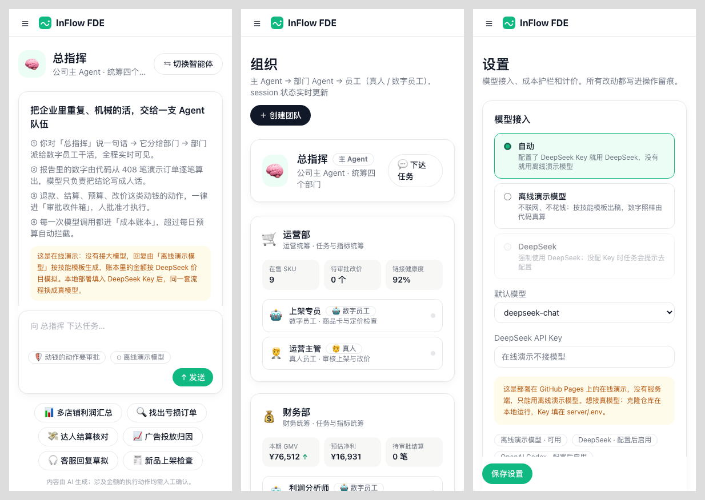

# InFlow FDE · 企业 AI 转型操盘台

> 把企业里重复、机械的活，交给一支 Agent 队伍：总指挥分活，数字员工干活；数字由代码算，动钱的事人拍板，每一分 AI 成本都记账。

**在线演示**：https://zj85997-hash.github.io/inflow-fde/

在线演示没有服务端，也不接大模型：整套接口在浏览器里跑，回复由「离线演示模型」按技能模板生成，数字照样由代码从订单逐笔算出。本地部署填入 DeepSeek Key，同一套流程就换成真模型。



## 这是什么

FDE（Forward Deployed Engineer，驻场 AI 工程师）的日常，是走进一家企业，找出它最机械的工作流，交给 AI 去跑。InFlow FDE 是做这件事的操盘台：

1. **诊断**：录入企业的工作流，AI 给每条打「机械程度」分，标出哪些能交给 Agent、哪些该留给人。
2. **装配**：按行业装插件包（技能 + 数据连接器 + 快捷入口 + 定时任务模板），组织成「总指挥 → 部门 Agent → 数字员工」三层。
3. **运行**：老板对总指挥说一句话，任务被分到部门、派给数字员工，过程实时可见。
4. **把关**：退款、结算、预算、改价这类动钱的动作，只进「审批收件箱」，人批准才算数，每一步写进操作留痕。
5. **算账**：每一次模型调用逐笔记账，按 Agent 和部门归因；超过每日预算，网关直接拦截。

演示公司是一家虚构的三店铺跨境电商，有 408 笔订单。其中「拾光饰品」毛利率最高，净利却是负的。找出钱漏在哪，就是演示的主线。

## 来历

InFlow FDE 由团队原型 AI-FDE-tool（Demo V1）发展而来。原型已经有 monorepo、DeepSeek 网关和成本账本、三层编排，以及 8 个中台页面；我把它改名为 InFlow FDE，接着做完了下面这些：

| 补了什么 | 说明 |
|---|---|
| 共享编排核心 `@inflow/core` | 服务端和在线演示用同一套代码：路由、技能、审批、留痕、接口 |
| 离线演示模型 | 没有 Key 也能完整跑通；回复按技能模板生成，账本按真实价目模拟计价 |
| 4 个数字员工的技能 | 利润分析师、广告归因师、客服应答员、上架专员：先用代码算数，再出稿，再提审批 |
| 审批收件箱 + 操作留痕 | AI 提出的动钱动作在这里批准或驳回，可以写备注，全程可查 |
| 设置页 + 预算护栏 | 切换模型、改每日预算和计价；超预算自动拦截 |
| 命令行 `pnpm fde` | 不开网页也能派活、审批、看账 |
| 测试 + 在线演示 | 18 个测试覆盖算数、分发、审批、护栏；GitHub Actions 自动测试并发布静态演示 |

## 页面

| 页面 | 内容 |
|---|---|
| 新任务 | 对总指挥或任一 Agent 下达任务；6 个场景快捷入口；分派过程、流式产出、审批卡片都在同一条会话里 |
| 组织 | 总指挥 → 4 个部门 → 数字员工 / 真人员工；财务、投放的指标由订单数据实时算出 |
| 审批收件箱 | 待审批 / 已处理 / 操作留痕；批准或驳回时可以写备注 |
| 插件中心 | 行业插件包（跨境电商包，另有金融、独立站两个占位包）、技能、连接器 |
| 定时任务 | 插件带来的模板：可以启用，也可以立即运行一次 |
| 工作流管理 | AI 给工作流打「机械程度」分，人确认后交给 Agent；讨论、决策类的建议留给人 |
| 知识库 | 退款政策、达人合作条款、投放基准、上架清单、SKU 台账；数字员工按条引用 |
| 成本账本 | 逐笔调用记录，按 Agent 和模型归因，今日花费对比预算 |
| 设置 | 模型模式、默认模型、每日预算、单次 token 上限、计价、重置演示数据 |
| 企业 Onboard → 对比方案 | 3 步录入企业档案，生成「现状 vs 优化后」对比方案（演示定价） |



## 6 个演示场景

| 快捷入口 | 谁来做 | 出什么 | 进审批的动作 |
|---|---|---|---|
| 📊 多店铺利润汇总 | 财务部 · 利润分析师 | 三店利润总览；拾光饰品净利率 -1.8%，钱漏在达人佣金、投流和退款 | 扣回退款订单上的达人佣金 ¥743.05 |
| 🔍 找出亏损订单 | 财务部 · 利润分析师 | 57 笔亏损单按店铺拆解，分清「退款吃掉利润」和「费用结构有问题」 | 同上 |
| 💸 达人结算核对 | 财务部 · 利润分析师 | 三家店的佣金率、退款订单上的佣金明细 | 三家店各一条扣回 |
| 📈 广告投放归因 | 投放部 · 广告归因师 | 漏斗对照基准线：判断是素材、出价还是落地页的问题 | 每天从拾光饰品挪 ¥42 预算到星尘家居 |
| 🎧 客服回复草拟 | 客服部 · 客服应答员 | 给客户的回复 + 内部备注，引用退款政策条款 | 退款 ¥129.00 |
| 🧾 新品上架检查 | 运营部 · 上架专员 | 上架清单逐项检查 + 单品利润核算；改价救不回来时，建议先谈佣金 | 改价（只在涨幅合理时提出） |

## 设计原则

1. **规矩交给知识库记，算数交给代码算。** 模型只负责把算好的数写成人话。接了真模型，数字也来自连接器的数据，提示词里写明「不许编造」。
2. **AI 出建议，人拍板，全程留痕。** 动钱的动作由技能用代码算出，进审批收件箱；模型说什么都不会直接动钱。
3. **每一分 AI 成本都可解释。** 网关逐调用回报用量，账本按 Agent 和部门归因，预算护栏兜底。
4. **底座标准化，行业包换皮复制。** 编排、审批、账本是底座；行业差异放在插件包和技能里，规则由企业自己改。

## 架构

```
web/                 控制台：Next.js 15 + Tailwind。在线演示时导出成静态页面，接口在浏览器里跑
server/              服务端：Fastify + SQLite + WebSocket；命令行 pnpm fde
plugins/             行业插件包：manifest.json（技能、连接器、快捷入口、定时任务模板）
packages/core/       编排核心：三层分发、技能、审批、留痕、知识库、演示数据、接口路由
packages/gateway/    模型网关：DeepSeek / 离线演示模型，预算护栏，逐调用回报用量
packages/contracts/  前后端共享的类型和事件协议
```

服务端和在线演示调用的是同一个 `createApp()`：服务端把存储接到 SQLite，在线演示接到浏览器内存（存进 localStorage）。所以在线演示里的每一个数，都和本地部署算出来的一样。



## 本地运行

需要 Node ≥ 20 和 pnpm。

```bash
pnpm install
pnpm dev
```

`pnpm dev` 会同时启动 server（8790 端口）和 web（3300 端口）。打开 http://127.0.0.1:3300，第一次启动会自动灌入演示数据。

不配 Key 也能用（离线演示模型）。要接 DeepSeek：

```bash
cp server/.env.example server/.env
```

在 `server/.env` 里填入 `DEEPSEEK_API_KEY`，然后重启 `pnpm dev`。Key 只放在服务端，不经过浏览器。

命令行：

```bash
pnpm fde status
pnpm fde run "帮我汇总三个店铺本月的真实利润"
pnpm fde approvals
pnpm fde approve <编号> 已核对
pnpm fde ledger
pnpm fde diagnose
```

其他命令：

```bash
pnpm test          # 18 个测试
pnpm typecheck
pnpm seed --reset  # 重新灌入演示数据，并清空任务、账本、审批
pnpm build:demo    # 导出静态演示到 web/out
```

## 路线图

- 定时任务按时间自动触发（现在可以启用和手动运行）
- 真实连接器：TikTok Shop、亚马逊 SP-API、广告平台数据导出
- 知识库上传、切片和检索
- 把连接器改造成独立的 MCP server
- 多租户、角色权限、审批分级（金额越大，审批人级别越高）

## 数据说明

店铺、商品、订单、人员全部是虚构的。订单用固定种子生成，不对应任何真实企业。

## 许可

MIT。作者：[付钟浩（Alex）](https://zj85997-hash.github.io/)。
